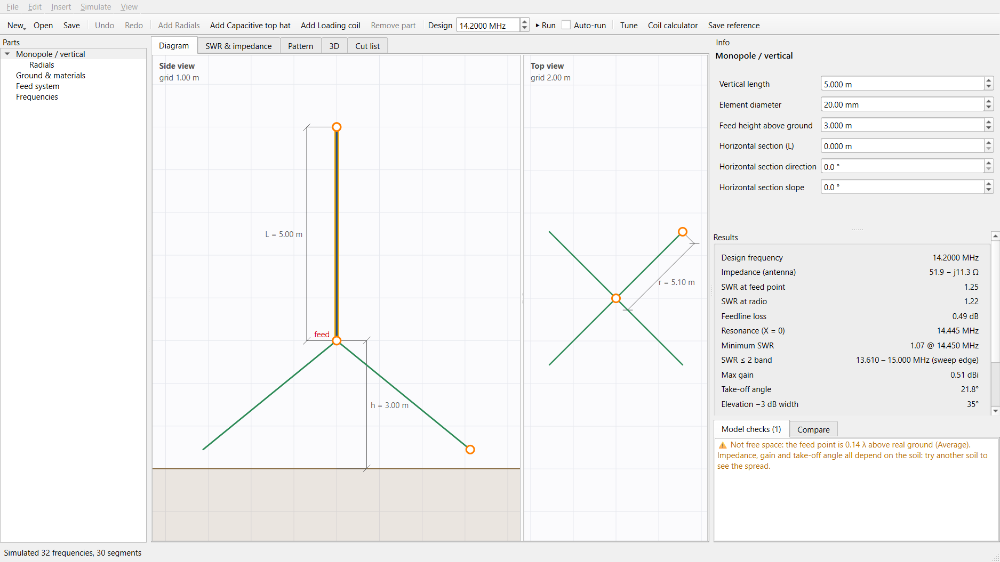
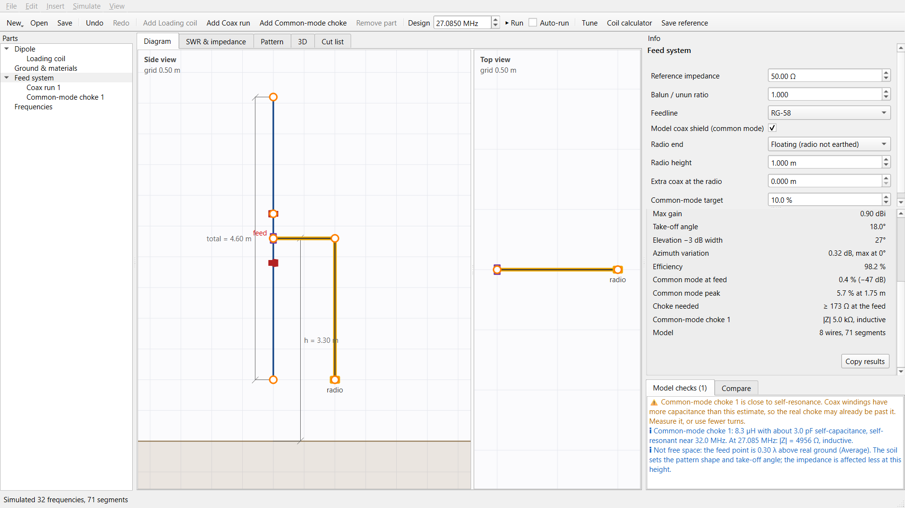
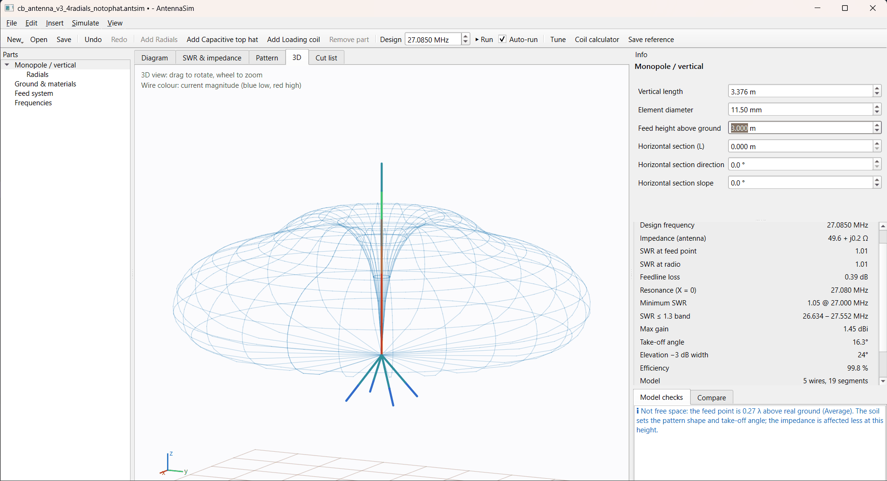

## What it is

A desktop program for designing wire antennas, modelled on OpenRocket (the rocket design tool). You pick the antenna type, edit it in 2D side and top views by dragging handles, and it simulates:
- **SWR** (standing wave ratio: how well the antenna matches the radio, 1.0 is perfect)
- **feed-point impedance**
- the **radiation pattern**, efficiency and take-off angle

It's written in Python with a Qt (PySide6) interface. The physics comes from NEC2, the standard antenna simulation engine. Two families work: monopole/vertical (with radials, top hats and loading coils) and dipole (flat, inverted V, sloping or vertical).

## Why I built it

I build CB radio antennas for 27 MHz from hardware-store parts. Existing tools are old and have a learning curve, and doing it myself gives full control over the features. I wanted something where I choose "vertical with four radials" and get numbers I can cut metal to.

## How it works

~~~
Project (.antsim, JSON) → Template → 3D wire model → model checks
  → nec2c (separate process) → currents & impedance
  → far field, SWR, feedline loss → results
~~~

- **Templates.** Each antenna type turns a handful of parameters into a 3D wire model. They also describe the diagram handles, dimension lines and the cut list (lengths to cut before building). Adding a type means writing one template; the UI, solver and analysis are shared.
- **Solver.** nec2c is compiled from vendored C source with MinGW and run as a subprocess on a generated NEC card deck. This also keeps its GPL licence separate from the app. Each frequency gets its own execution block, so frequency-dependent coil losses are right across the sweep.
- **UI.** Simulations run in a background thread pool. Every edit is undoable. Designs can be saved as references and compared, with overlaid plots and differences shown beside each value.
- **Common mode.** The outside of the coax shield can be added as a wire. It joins the antenna at the feed point and follows coax "runs" down to the radio, with optional chokes along it. Common-mode current is current flowing on the outside of the shield instead of inside the cable: it radiates and detunes the antenna.

## What went wrong

- **Ground-mounted verticals gave nonsense over real soil.** NEC2 cannot properly connect a wire to lossy ground. Fix: solve the currents over perfect ground plus a series ground-loss resistance at the feed. The far-field pattern is then computed separately in Python with Fresnel reflection coefficients for the real soil. It matches NEC's own pattern output within 0.013 dB.
- **The auto-tuner found the wrong resonance.** Resonance means reactance (the imaginary part of the impedance) is zero. Searching for any sign change sometimes landed on the ¾-wave resonance, or on an antiresonance, which is a pole, not a zero. Fix: scan upward and take the first negative-to-positive crossing, then refine it with the Illinois false-position method.
- **Short loaded antennas tuned 8% wrong.** NEC splits each wire into segments. With the usual rule of λ/20 per segment, a short loaded dipole got only 8 segments and the calculated coil value was 8% too high. Fix: also require at least 40 segments across the antenna's size. A test checks the default against a model eight times finer.
- **The Run button silently did nothing.** The Qt signal objects of the background jobs were garbage-collected before the jobs finished. Fix: keep references to running jobs, add a watchdog timer, and show solver errors in red. A later, cosmetic bug: dozens of empty windows flashed up on every run. Old result labels were being detached from their parent before deletion, which briefly made each one its own window.

## The parts that had to work

- **The 2D/3D split.** Editing is 2D and parametric, but NEC always gets a 3D wire model. So a new antenna type never touches the solver or the UI.
- **Choke requirement without brute force.** The structure is linear, so two extra solves give the shield current for *any* choke impedance: one drives the feed, the other drives the choke point. The required choke impedance then comes from arithmetic, not from repeated NEC runs. Checked against a direct simulation with that choke: 10.0% predicted, 9.99965% simulated.
- **An unbalanced feed always leaks.** A coax connected straight to a dipole carries some common-mode current even when it hangs perfectly perpendicular. The shield is wired to one leg only. That is what a 1:1 current balun fixes.
- **Model checks.** NEC2 gives wrong answers silently when its thin-wire rules are broken: segments too long, wires too fat, wires too close or crossing. The app checks these before running and says which results depend on the soil model.
- **Air-wound coax chokes have a self-resonance.** Using Wheeler's inductance formula plus Medhurst's self-capacitance estimate, my 14-turn choke on a 60 mm former comes out at about 8.3 µH, self-resonant near 32 MHz. That is very close to 27 MHz, and real coax windings have more capacitance than the estimate. A likely reason it failed.

## Where AI came in

Claude (Anthropic) wrote the code, the tests and the README. I made the decisions:
- stack (Python + Qt, embedded NEC2) and scope (vertical antennas first)
- features: comparisons, the overview, the vertical dipole, coax routing, the choke requirement box, the perfect-choke option

I tested every version as a user and reported the bugs I found: the silent Run button, the flat SWR plot after zooming, negative angles that couldn't be typed, the flashing windows. I also checked the simulations against the physics I expected.

## Current state

- Works:
  - monopole/vertical and dipole families
  - radials, top hats, loading coils
  - tuning to resonance
  - comparisons, cut list, `.nec` export
  - coax common-mode modelling with chokes
- 96 automated tests: NEC2 reference cases (a quarter-wave monopole gives about 36 Ω, a half-wave dipole about 73 Ω), plus the analysis maths and UI behaviour.
- Not validated against a real antenna yet. TODO: measured SWR, as I don't have an SWR meter yet.
- Missing:
  - fan dipole and traps, end-fed, loops, bowtie/discone/halo, sleeve dipole
  - a Windows installer
  - reordering coax runs
- Licence undecided.

## What carried over

- TODO: confirm. Check a simulator against known reference values before trusting its numbers.
- TODO: confirm. Linear superposition as a way to avoid brute-force searches.
