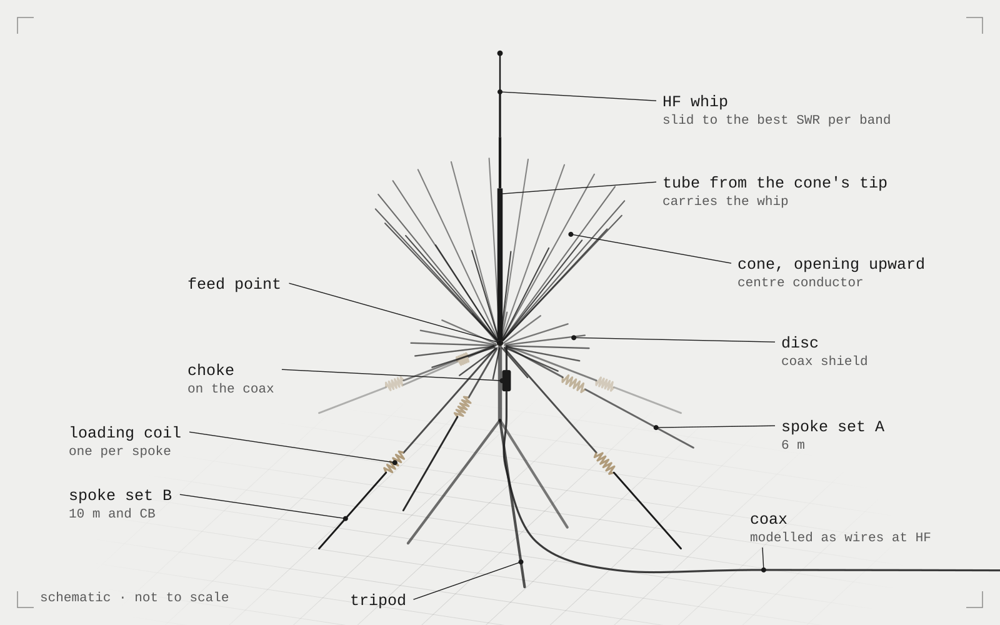
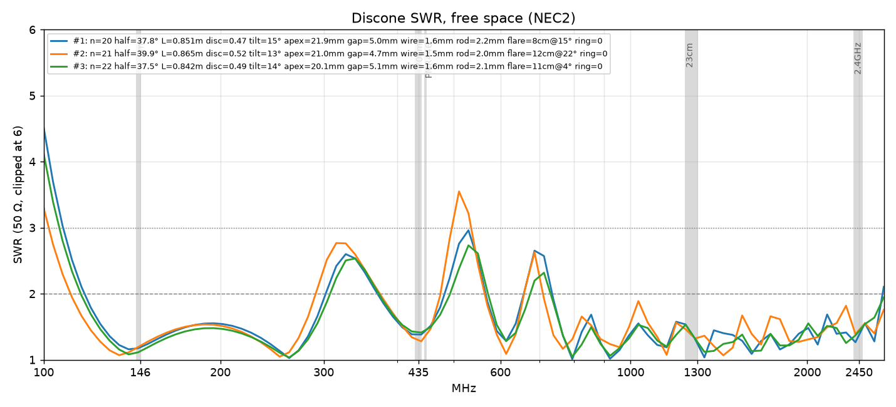
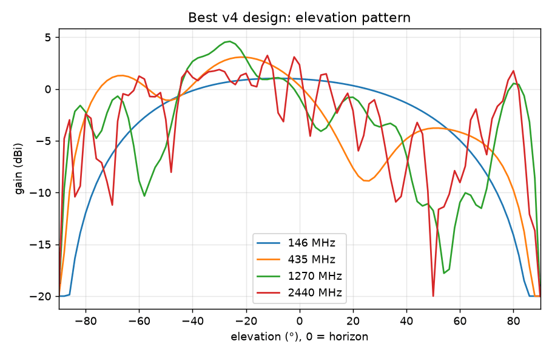
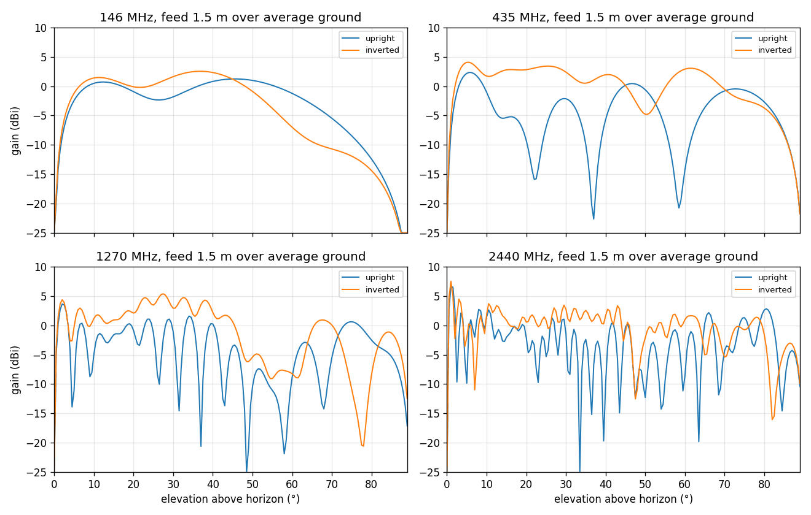

## What it is

A design for a portable antenna for my brand idea, Jansky Systems:
- **A discone** (a cone and a disc fed against each other) that receives roughly 108 MHz to 2.5 GHz and transmits on the 2 m, 70 cm, ISM 868/915 MHz and 23 cm bands.
- **An HF vertical folded into it** for 6 m, 10 m and CB.

Nobody hand-drew this antenna. A Python optimizer did:
- it generates designs and simulates each one in NEC2, about 70 simulations per design
- it scores them and evolves better ones
- over three weeks it grew from a parameter sweep into a search for whole design *styles*, sized for a 192-core cloud machine

## Why I built it

I wanted to sell antennas, and the benchmark is the Diamond D3000N: a wideband discone, but receive-only below 50 MHz. My question was whether one portable antenna could do both: receive almost everything, transmit on the ham and ISM bands, *and* work on HF. I had no idea how to design that. I didn't know what a discone really was, what common-mode current was, or what a segment in a simulation meant. So I had an AI explain it, and we built a tool that designs it instead of me.

The motto from the start was **"let the frequencies sort themselves out"**: put enough conductors in the right places, and each band finds the part of the antenna that resonates for it.

## How it works

**The antenna ("layout C").**
- **The discone is upside down:** the disc at the bottom, the cone opening upward.
- **Swapped feed:** the coax shield goes to the disc, the centre conductor to the cone.
- **Why it's flipped:** an HF whip can sit on a tube that rises from the cone's tip, and long spokes can hang from the disc as the HF counterpoise (the "ground half" of a vertical).
- **Two spoke sets:**
  - set A tuned for 6 m
  - set B for 10 m and CB
  - each spoke has a loading coil, so it's electrically long at HF but doesn't wreck the discone at VHF/UHF
- **Frequencies sort themselves out:** at 30 MHz the whip and spokes do the work; at 1 GHz the cone and disc do.

**The simulation.** NEC2 uses the method of moments:
- every wire is cut into segments, and NEC builds an N×N matrix of how each segment's current affects every other
- filling that matrix costs about N², solving it about N³
- a design is about 70 such solves:
  - VHF/UHF band points and 24 receive points in free space
  - HF over real ground, with the tripod and the coax modelled as wires
- the whip is "slid" to the best SWR per band, like in the field
- everything runs at two coil self-capacitances, and the worse result counts

**The optimizer.** Each design becomes a score: per band, SWR above a target is punished hard (a squared "wall"), plus terms for low-angle gain and receive SWR.
- v1/v2: differential evolution (DE)
- v3: three algorithms, switchable mid-run (DE, L-SHADE, and my "trends" idea)
- experiment X: a style search, with an L-SHADE explorer, HDBSCAN clustering, a CMA-ES run per style, and a time controller for a 20-hour cloud run

## How it got here

**1. A CB antenna and common mode.**
- **What I asked:** we started with my CB ground-plane: why does the SWR change when I move the coax?
- **The answer:** the outside of the coax shield is part of the antenna (common-mode current).
- **The model:** a real feedline in NEC, with the shield as wires to the radio, chokes as loads on it, and real ground.
- **What I learned:** mainly that I knew almost nothing about this.

**2. The discone, v1–v4.** Four optimizer versions in two days, each testing a "ridiculous" idea:

| Idea | Result |
|---|---|
| Disc rods tilted up | kept as a parameter |
| Alternating cone rod lengths, to smear out resonances | didn't help, removed |
| A wire cone instead of rods | kept |
| A flared rim | kept as a parameter in v4 |
| A metal hoop joining the cone tips | it hurt |

Plus a tolerance command for build errors.

**3. Orientation.** An orientation study compared, over ground with a real coax:
- A: upright
- B: inverted with normal wiring
- C: inverted with swapped wiring

C won the layout because it makes room for the whip and the spokes.

**4. HF.**
- **Studied:** whip length per band, choke placement, and long spokes as counterpoise.
- **Found:** plain long spokes ruin the discone's low end. Coil-loaded spokes fix that.

**5. Combined optimizer (v1 → v2 → v3).** Over several nights on my laptop under WSL. v3's best design:
- **Score:** 3.12 in the search, 3.09 when re-checked at finer segmentation
- **Size:** 8,218 designs
- **Shape:** n = 20 cone wires, 3 A spokes, 4 B spokes

**6. Experiment X.**
- **Ranges:** much wider (20 parameters)
- **Bands:** new, including CB40 and stricter targets
- **Second score:** buildability, which the search ignores
- **Goal:** find as many different design *styles* as possible, then develop each one

<!-- IMAGE: SWR vs frequency plot of the v3 winner, 100 MHz–2.7 GHz, with the TX bands shaded -->

## What went wrong

- **The 6 m results didn't converge.** Changing the segmentation changed the answer.
  - **Cause:** the loading coil was one segment whose length changed with the mesh, and so did its stray capacitance.
  - **Fix:** the coil is now always one 15 mm loaded segment, with the spoke segments growing 1.25× away from it.
- **Crowded hubs.**
  - **v1–v4:** started every disc rod at the axis. NEC results near the crowded apex were only indicative above ~1.5 GHz. v2 of the combined optimizer moved every rod's start onto a hub ring.
  - **Experiment X** allowed hubs up to 100 mm. At 2.5 GHz the hub radials got several segments each, and their first segments overlapped near the centre: **458 of 600 random designs failed NEC's geometry check**. In the real run all of those would have scored as failures. Crowded radials now get thinner, and it's 0 of 800, while the v3 winner's model is wire-for-wire unchanged.
  - **The hub-fit limit:** elements must fit around the hub with 30 % spacing, or the design is rejected before simulating.
- **The score convention flipped.**
  - v3 scored rejected designs as "100 + how far out", which was safely worse than any real v3 score.
  - Random X designs score in the hundreds to thousands (SWR 20 hits the walls), so rejected designs would have looked *better* than real ones.
  - Rejected is now 100,000+.
- **The style search found duplicates, then collapsed.** On a test landscape with a known number of valleys:
  - the planned rule ("a cluster is new if it holds none of a style's stored points") made 11–132 duplicate styles
  - L-SHADE put 95 % of its designs into one valley
  - **fixes:**
    - a hill-valley test: simulate 3 designs on the line between two candidates; a worse one in between means a ridge, so a different valley
    - a taboo that replaces explorer designs sitting in an already-found valley
  - **result:** 7 styles in 7 of 7 valleys, 0 duplicates
- **Two libraries couldn't load together.** NEC (pynec-accel) and scikit-learn crash together with "cannot allocate memory in static TLS block". A glibc setting fixes it; the script restarts itself with it.

## Who did what

I want to be honest here, because this page is AI-assisted. Claude wrote almost all the code. My role changed from phase to phase:

| Phase | Me | Claude |
|---|---|---|
| The antenna idea | idea and requirements | helped me formulate it and check that it made sense (cooperators) |
| CB antenna, common mode, chokes | asked, learned that I knew barely anything | explained, modelled the coax in NEC |
| First tests, solver comparisons | couldn't really help | engineer |
| How discones work | student | teacher |
| DE optimizer v1–v4, discone details | ran it; started proposing the "ridiculous" ideas (creative role) | built it, tested every idea, explained more while it ran |
| Analyzing optimizer output | analyzed with Claude; got lost when comparing too many options | analyzed (both engineers) |
| Adding HF, spokes, coils | proposed ideas, read graphs | tests and models (both engineers) |
| Discone parameters | discussed | discussed |
| How the optimizer works, impedance, reactance, why solves are slow | student (quizzed on impedance) | teacher |
| WSL problems | fixed together | fixed together |
| Speeding up the solver (GPU path, scheduling) | threw in ideas | engineer |
| DE with trends, L-SHADE | thinker: the trends idea is mine | turned it into an algorithm, tested it |
| Experiment X | ideas and decisions | built and tested; changed the plan where tests disproved it |

My own ideas in experiment X:

- open search including nearly unbuildable parameter ranges, with revised scoring. Now any formed design trend which is within the "buildable range" as I defined it gets more compute to form more trends faster, and trends forming outside this zone get less (50/50 trend vs DE population for the buildable trends and 20/80 for the free-range trends)
- more styles, each developed to the max *after* the main population has fully decreased by the L-SHADE component of the algorithm
- dynamic/automatic time management of the optimizer (an urgency controller with a hidden time buffer), based on the average time of DE generations to complete and trends to form + trend generations to be simulated. All are forecasted mathematically (by means of extrapolating a graph).

  Note: it follows my motto of "things must sort themselves out" (during discone design I designed it with "frequencies sort themselves out" as the philosophy).

  In this case the algorithm dynamically adjusts the L-SHADE population reduction every generation to make sure it will have enough time to simulate the population until it's done and then fully develop the trends until they are also done. This is because I don't want to manually set too many parameters when it can do that itself, and then not cut off too many potentially good designs.
- a buildability ("imaginary") score that the search must ignore, but the final ranking takes into account
- taboo via clustering (trends form)
- skipping HF simulations for hopeless designs (we run it in shadow mode first)
- choosing HDBSCAN over OPTICS once I understood why for the trend clustering

## The trends idea, and how it held up

L-SHADE is DE that learns its own step size and mixing rate from the trials that worked.

My idea came from the DE formula Claude had taught me, where a trial moves toward one of the best designs:
- split the population into "winners" and "diversity" members
- detect a *trend*: a group of good designs improving in the same direction
- spend extra designs on pushing it, without taking members from the explorer
- store a trend when it saturates, with an id and the parameters it favours
- spend less on new trends that look like a stored one

Claude built it as an L-SHADE explorer plus CMA-ES "trend runs". We raced it on a stand-in (a Gaussian-process model fitted to the 8,612 real simulations of the v1 run), 16 runs of 7,000 designs each:

| | Random start, median best | Warm start, median best | Designs to reach 3.5 (warm) |
|---|---|---|---|
| DE (v1/v2) | 3.25 | 3.13 | 4,617 |
| L-SHADE | 2.87 | **2.58** | 3,426 |
| L-SHADE + trends | **2.82** | 2.80 | **2,078** |

Trends reached good designs about 1.6× sooner; L-SHADE finished best when started from good designs. Both clearly beat plain DE. The idea survived into experiment X as the "styles".

## The parts that had to work

- **Method of moments cost:** N² to fill, N³ to solve. That's why segment count drives everything, why design size is capped at 8,000 segments, and why a GPU only helped ~5–10 % overall. Filling the matrix stays on the CPU.
- **Common-mode current:** the coax shield radiates unless choked. That's why the coax and a resistive choke are in every HF simulation, at two run lengths.
- **Coil self-capacitance** is the main build risk of the v3 winner:

  | Coil self-capacitance | 2 m SWR | 10 m SWR |
  |---|---|---|
  | 0.5 pF | 1.17 | 1.50 |
  | 0.7–1.4 pF (scored range) | 1.56 | 1.59 |
  | 2.0 pF | 1.84 | 2.12 |

  Coil A self-resonates at 124–175 MHz, right across 2 m.
- **The scoring:** squared walls above each target. A pair rule for 10 m / CB lets a design be excellent on one band instead of mediocre on both.
- **The hill-valley test and the taboo:** they take the style search from 3 styles in one valley to 7 in 7 on the test landscape.
- **Checkpointing:** the whole search state is saved after every batch. A stop or crash mid-batch, then resume, gives the identical design sequence (tested: 5,040 designs bit-identical).

## Where AI came in

Claude wrote nearly all the code:
- the optimizers
- the NEC models
- the scheduler
- a C++/CUDA LU solver path for NEC
- the AWS setup script

It also ran most of the tests. It taught me the theory along the way, including quizzing me on impedance and reactance. What I did:
- set the goal and the bands
- supplied my own antenna problems
- proposed design and algorithm ideas
- made the decisions
- ran the long optimizations on my own machine and read the results with it

I can explain the concepts on this page. I could not have written the code alone.

## Current state

- **Done:** v3 optimizer and its best design (simulation only, re-checked at finer segmentation).
- **Built and tested:**
  - **The code:** experiment X (`final_opt_x.py`), its AWS setup script and a guide. It was tested on landscapes where the answer is known, plus real NEC on extreme designs.
- **Next:** one ~20-hour run on a 192-core AWS spot instance (about $44–68).
- **For reference:** the v3 winner scores 5.10 under X's stricter scoring; the new 2 m rule alone costs it 3.04.
- **Not done:** no antenna built, no VNA measurements. TODO: confirm whether any hardware has been made.
- **Known weak spots:**
  - the model uses a thin rod for the real ~30 mm body tube
  - coils are idealized
  - the time controller's forecasts lean conservative (tests finished at 16–17.7 of 20 h)

## What carried over

- How to check a simulation before trusting it: convergence with segmentation, re-checks at finer settings, stress tests nobody optimized for.
- Testing an algorithm on a fake problem where I know the answer, before spending real compute on it. Most of experiment X's real bugs were found that way.
- Writing down every test result in a learnings log, so the next run starts from evidence instead of memory.
