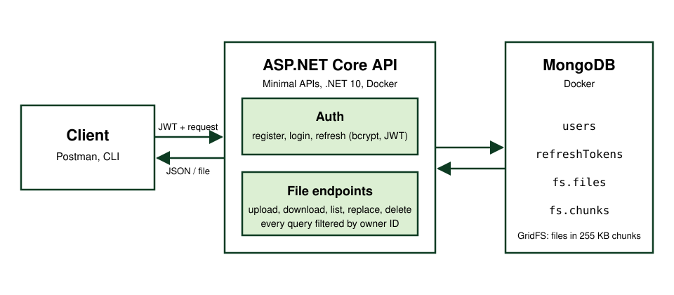

## What it is

s23bucket is my own small cloud storage. It's a web API (ASP.NET Core Minimal APIs on .NET 10) where users register, log in and then upload, download, list, replace and delete files in their own private folder tree. The files live in MongoDB using GridFS, which is MongoDB's way of storing big files by cutting them into 255 KB chunks. The API and the database run as two containers with Docker Compose.

## Why I built it

It started as a school project during a "Lernperiode" (a self-directed learning period at my school). I wanted to learn clean C# backend development on something I'd actually use: a private file server for a homemade server. I also wanted to try an idea: other backends should be able to let *their* users fetch specific files from my server for a short time, without those users needing an account. The project sat untouched for about six months. In October 2026 I picked it up again to finish it.

## How it works



- **Auth:** passwords are hashed with bcrypt. Login returns a JWT, a signed token the client sends with every request, valid for 60 minutes, plus a refresh token stored in MongoDB.
- **Storage:** every file or folder is one document in GridFS's `fs.files` collection, and the bytes sit in `fs.chunks`. Folders are zero-length entries. The metadata holds the owner ID, the parent folder (like `/docs/work`) and the type.
- **Virtual folder tree:** there are no real directories. Listing `/docs` means "find all entries whose parent is exactly `/docs` and whose owner is me". Every user's tree starts at `/`, and every query filters by the owner ID. That filter is the actual security boundary: if user B types user A's path, it simply searches B's own tree and finds nothing.
- **Paths:** one normalizer decides what a valid path is: it starts with `/`, has no trailing `/`, and no `.`, `..` or empty segments. Invalid paths are rejected, never "repaired".
- **External services (barely started):** the idea is that a service like my friend Alex's music app "Spotifake" can register at my file server. Its users then get a token from his system that allows them to do a single request directly to my server, without an account on mine. So far a service registers with an API key, stored as a bcrypt hash, and can request a short-lived token for a set of files. The request is kept in memory for one minute under a random ID that goes into the token.

## What went wrong

**Constant-time login.** A login that fails instantly for unknown usernames, but takes about 100 ms for real ones, tells an attacker which usernames exist. That's called a timing attack. My first fix compared against a made-up string. That doesn't work: bcrypt reads its cost factor from the hash itself, so a fake hash means no expensive work. While fixing it I also deleted a `!` and briefly made login accept wrong passwords. My second fix put the dummy hash in the constructor of a service that's created fresh for every request, so it was recomputed on every login. In the end it became one precomputed hash:

```csharp
private static readonly User _dummyUser = new User
{
    Username = "dummy",
    HashedPassword = BCrypt.Net.BCrypt.HashPassword("dummy")
};
```

Correct login, wrong password and unknown user then measured 122, 119 and 114 ms.

**Configuration.** Secrets were committed in `appsettings.json` and `.env`, and I had to rewrite the git history to get them out. The connection string arrived as `''` because the variable name in Docker Compose didn't match the key in `.env`: Compose quietly inserts an empty string instead of failing. The JWT signing key was 232 bits, but HS256 needs at least 256, so token creation failed with `IDX10720`. Running the API outside Docker also failed, because the hostname `mongodb` only exists inside the Compose network.

**MongoDB fails silently.** When a query uses a field name that doesn't exist, MongoDB doesn't throw an error. It just returns nothing. I renamed a metadata field and forgot one filter, and "get file by path" quietly returned 404s. I hit the same class of bug with `/test/` vs `/test`: upload stored one form and lookup searched for the other.

**500s from the serializer.** Two crashes happened after my code had already returned. One endpoint returned a `Task` I forgot to `await`, so ASP.NET tried to turn the Task object itself into JSON. Another returned MongoDB's own `GridFSFileInfo`, and the serializer crashed on a `BsonObjectId` it tried to read as a boolean. The fix was to return my own small DTO, never driver types.

## The parts that had to work

- **Why the ownerId filter is the security model,** and why the API answers 404 rather than 403 for someone else's file: a 403 would confirm the file exists.
- **ASP.NET configuration layers:** `appsettings.json` → environment file → user secrets → environment variables, where the later source wins and `__` becomes `:`. Plus how Docker Compose moves a value from `.env` into the container.
- **JWTs are signed, not encrypted.** Anyone can read the payload, and the shared key only proves the token wasn't changed.
- **Dependency injection lifetimes:** scoped means one instance per request, singleton means one for the whole app, and static fields are shared by everyone.
- **Safe replace:** upload the new version first, then delete the old one, so a failed upload never loses the user's file.
- **Separating the service from HTTP:** the service returns a `ServiceResult<T>` (status enum + value), and only the endpoint decides the HTTP status code.

## Where AI came in

In the first phase I used Gemini to manage the project. The Docker Compose file was AI-generated, and so was the path normalizer. The code was mostly handwritten. When I came back, I worked with Claude: it explained concepts, quizzed me, reviewed my code and helped design the virtual filesystem. With what I learnt I was able to redo some things based on my own understanding. 95% of the code I wrote myself and tested in Postman. For the last round of fixes I let Claude test them with 30 end-to-end test scenarios.

## Current state

- Works: register, login, token refresh, upload, download by ID or path, folders, listing, delete (folders only when empty), replacing a file's content, and isolation between users.
- Not built yet: renaming/moving (PATCH), sharing files between users, and validating file and folder names (`a/b` is still accepted as a name).
- External services: barely started and still full of security holes. Registration and token creation exist, but nothing accepts the client token yet, and the token request endpoint isn't protected.
- Not deployed yet. First I want to finish the file server itself; only then will I build an ARM Docker image to run it on my Raspberry Pi 4.
- An earlier version had a Spectre.Console command-line client. The current repo doesn't include it.

## What carried over

- **Before trusting an `if`, I write down every case and trace it.** Most of my bugs were inverted conditions, or two places that had to agree and didn't.
- **I test the endpoint I just touched before moving on,** instead of finding the break three changes later.
- **I write the design down before coding.** After six months away I had forgotten why I'd made half my decisions.
